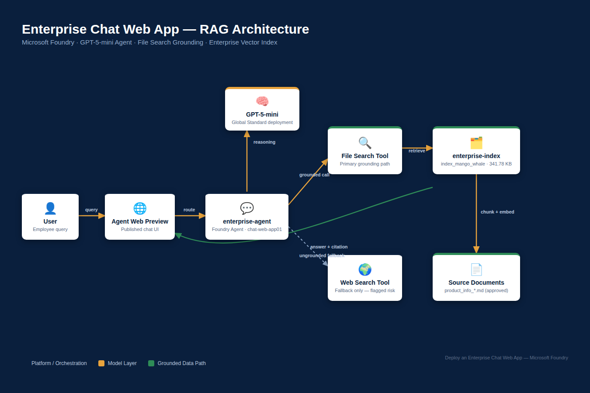

# Enterprise Chat Web App — Microsoft Foundry (RAG-Grounded Agent)

A retrieval-augmented AI agent built on Microsoft Foundry (GPT-5-mini + File Search) that answers employee questions using only approved internal documentation — with every claim traceable to a source file. Delivered and documented using an AI Project Management governance framework (Charter, RAID, RACI, Quality Gates, UAT).



## Why this exists

Generic LLM responses can't be trusted for internal product or policy questions — they hallucinate, cite the wrong brand, or quote outdated pricing. This project grounds the agent in a controlled `enterprise-index` vector store so every answer is verifiable.

## What was built

| Component | Detail |
|---|---|
| Platform | Microsoft Foundry project `chat-web-app01` |
| Agent | `enterprise-agent`, model `gpt-5-mini` (Global Standard deployment) |
| Grounding | File Search tool → `enterprise-index` (`index_mango_whale_8qmcynjnyr`, 341.78 KB) |
| Fallback tool | Web Search (Grounding with Bing) — flagged as a risk, see RAID R2 |
| Validation | Baseline (ungrounded) vs. grounded response comparison, plus Agent Web Preview |

## The proof: before vs. after grounding

**Before grounding** — the agent answered a different product entirely, in the wrong currency:

> *"Do you mean the Be Lenka 'Trailwalker' hiking/barefoot shoe?... €159.90... ≈ $185"*

**After grounding** — same question, now correctly sourced from the internal index:

> *"The TrailWalker Hiking Shoes are listed at $110."* — tagged **File search**, with a document citation.

That delta is the entire point of RAG, and it's captured step-by-step in `/screenshots`.

## Repository structure

```
enterprise-chat-foundry/
├── README.md                          # you are here
├── architecture/
│   ├── architecture-diagram.png       # navy/amber/green system diagram
│   └── diagram.html                   # source (Playwright-rendered)
├── screenshots/
│   ├── 01_create-agent.png
│   ├── 02_agent-playground-initialized.png
│   ├── 03_baseline-ungrounded-response.png
│   ├── 04_file-search-tool-configured.png
│   ├── 05_grounded-response-with-citation.png
│   └── 06_agent-web-preview.png
├── governance/
│   ├── 01_Project_Charter.md
│   ├── 02_RAID_Log.md
│   ├── 03_RACI_Matrix.md
│   ├── 04_Quality_Gate_Scorecard.md
│   └── 05_UAT_Checklist.md
└── product-info/
    └── README.md                      # placeholder — see note below
```

> **Note:** The indexed source documents (`product_info_*.md`, the Contoso Trek retail sample data) weren't part of this upload, so `/product-info` currently only contains a placeholder explaining what belongs there. See that file for how to complete it.

## Governance approach

This build was run the way a production rollout would be — not just "does the demo work," but "can an organization trust and operate this."

- **[Project Charter](governance/01_Project_Charter.md)** — scope, objective, success criteria, stakeholders
- **[RAID Log](governance/02_RAID_Log.md)** — data governance risk, Web Search fallback risk (observed in testing), index staleness risk
- **[RACI Matrix](governance/03_RACI_Matrix.md)** — ownership across delivery, content approval, and security review
- **[Quality Gate Scorecard](governance/04_Quality_Gate_Scorecard.md)** — 7 gates, each tied to a screenshot as evidence
- **[UAT Checklist](governance/05_UAT_Checklist.md)** — formal before/after test cases with sign-off

## Key finding worth calling out

The baseline test didn't just return "I don't know" — it confidently answered with the **wrong brand and wrong currency**, sourced from the open web. That's logged as RAID risk **R2** and is exactly the kind of silent failure mode a Quality Gate process exists to catch before it reaches production.

## Next steps for a real production rollout

- Disable or gate the Web Search fallback tool (RAID R2)
- Add a budget alert in Azure Cost Management (RAID R3)
- Define and staff the index refresh cadence (RAID R4 / RACI)
- Secure a Microsoft 365 Business License to move from Web Preview to full deployment

---

*Built as a hands-on lab (K21Academy — "Deploy an Enterprise Chat Web App using Microsoft Foundry") and delivered through an AI Project Management lens by Jaswant Singh, PMP, AWS Certified AI Practitioner.*
